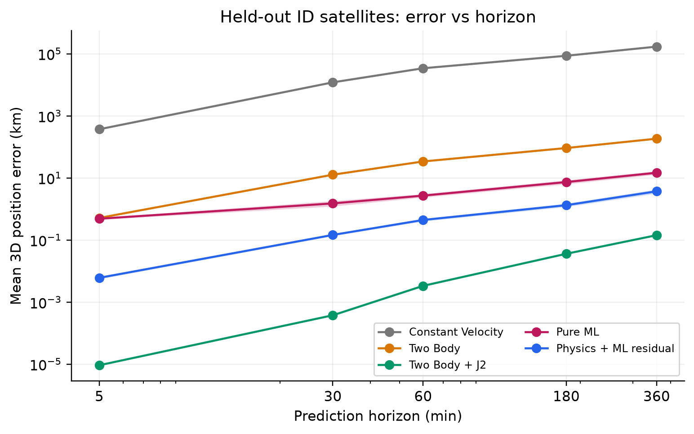
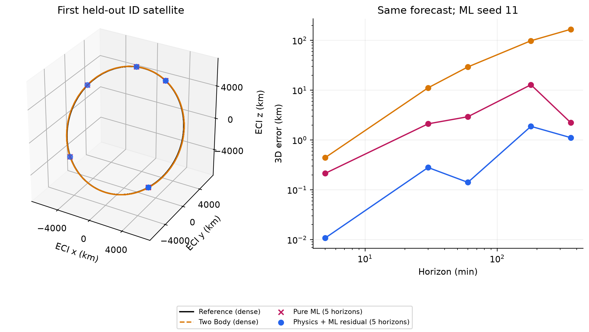
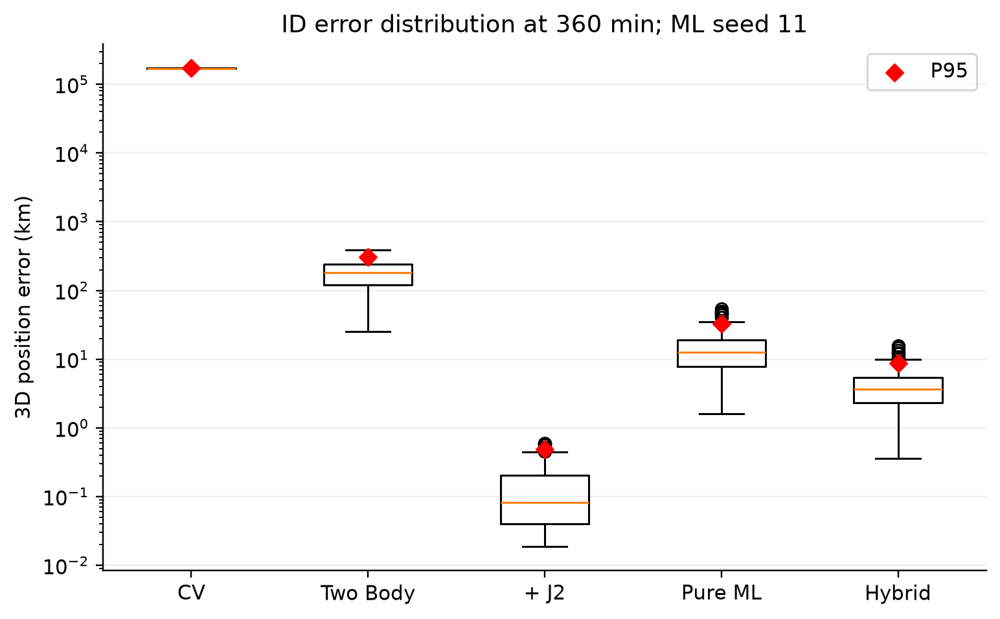
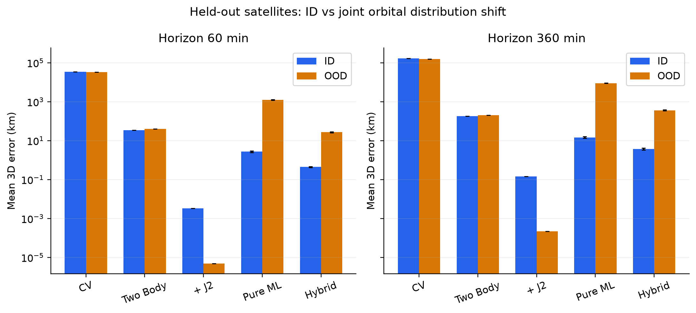
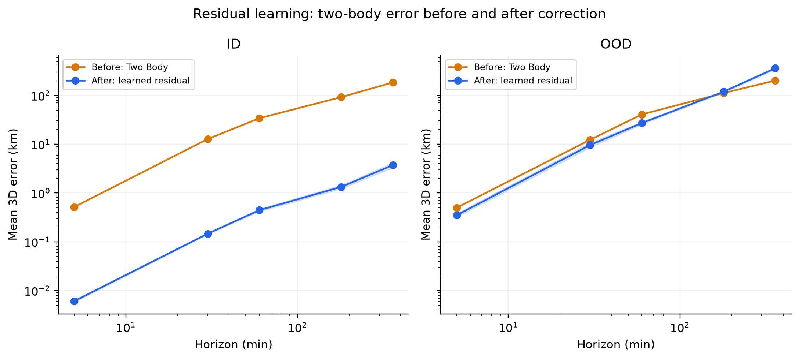

# Physics vs ML vs Hybrid orbital prediction

## Objective
Can machine learning improve a physics-based orbital predictor under model mismatch,
longer prediction horizons and distribution shift? This is a **controlled synthetic
benchmark**, not a flight-ready orbit determination system.

## Problem formulation
Given an exact inertial state $(r_t,v_t)$, predict positions at 5, 30, 60, 180 and
360 minutes. Targets come from numerical integration with central gravity, J2
and a fixed exponential atmosphere. No SGP4-generated labels are used.

## Physics models
Constant velocity uses $r_t+v_t h$. Two Body integrates
$\ddot r=-\mu r/\|r\|^3$. Two Body + J2 adds

$$a_{J2}=\frac{3J_2\mu R_E^2}{2\|r\|^5}
[x(5z^2/\|r\|^2-1),y(5z^2/\|r\|^2-1),z(5z^2/\|r\|^2-3)]^T.$$

The reference additionally uses $a_D=-\frac12(C_D A/m)\rho\|v_{rel}\|v_{rel}$,
with a co-rotating atmosphere, $C_D A/m=0.015$ m²/kg and
$\rho(h)=4\times10^{-12}\exp[-(h-400)/60]$ kg/m³ (altitude in km).
This atmosphere is a toy LEO model. Integration uses DOP853, km and seconds;
solver tolerances and a tighter-tolerance comparison are saved with every run.

## ML and hybrid residual model
Two independent MLPs (96–96 tanh units) predict all five horizons directly.
Pure ML predicts position; the hybrid learns
$r^{hybrid}=r^{two-body}+f_\theta(X)$ with target $r^{reference}-r^{two-body}$.
Both minimize MSE of train-standardized output coordinates, with equal coordinate
and horizon weighting, Adam and validation-selected checkpoints.

Inputs are current radius, radial/transverse velocity, and the three RTN basis
projections onto Earth's spin axis. Outputs use the initial RTN frame and rotate
back to inertial coordinates. These shared geometric features use no future states
or propagated positions. A recurrent model is unnecessary for this exact-state
Markov experiment. Hybrid inference additionally requires two-body propagation.

## Experimental protocol
Data seed: 2026. Whole synthetic satellites are assigned to train/validation/ID test/OOD
(96/24/24/24); each has 12 origins separated by 7 h, longer than any forecast.
The ID test is a leave-satellites-out holdout, not leave-one-out cross-validation.
No satellite or forecast window crosses a split; all scalers fit train only.
Validation controls checkpoint selection, never ID test or OOD.

ID initial semimajor-axis altitudes are 450–650 km, inclinations 35–65°,
eccentricities 0–0.008. OOD uses 800–1100 km, 90–105°, 0–0.015.
RAAN, argument of perigee and true anomaly are uniform over a full turn.
The same dataset is used for ML seeds 11, 22, 33. Reported spread reflects
training randomness, not population uncertainty; samples within a satellite are correlated.

## Results
<!-- RESULTS:START -->
Mean 3D error in **km** on held-out ID satellites; OOD column is at the longest horizon.
ML entries are mean ± sample std across training seeds, not confidence intervals.

| Model | 5 min | 30 min | 60 min | 180 min | 360 min | OOD |
|---|---:|---:|---:|---:|---:|---:|
| Constant Velocity | 372 | 1.21e+04 | 3.43e+04 | 8.66e+04 | 1.71e+05 | 1.57e+05 |
| Two Body | 0.517 | 12.8 | 34.1 | 92.3 | 185 | 202 |
| Two Body + J2 | 9.28e-06 | 0.000378 | 0.00335 | 0.0362 | 0.144 | 0.000224 |
| Pure ML | 0.487 ± 0.016 | 1.51 ± 0.24 | 2.71 ± 0.24 | 7.39 ± 0.79 | 14.8 ± 1.4 | 9e+03 ± 1.1e+02 |
| Physics + ML residual | 0.00607 ± 0.00029 | 0.146 ± 0.0045 | 0.444 ± 0.025 | 1.33 ± 0.11 | 3.73 ± 0.42 | 360 ± 21 |

### Key findings

- At 360 min on ID, the hybrid changes two-body error by -98.0% (185 → 3.73 km).
- At 360 min on OOD, the hybrid changes two-body error by +78.3% (202 → 360 km).
- The lowest ID mean error at 360 min is obtained by **Two Body + J2**.
- Pure ML has 14.8 km ID mean error at 360 min; no superiority over physics is assumed.
<!-- RESULTS:END -->

MAE 3D means mean Euclidean position error; RMSE 3D is the square root of
mean squared Euclidean error. CSV/JSON also contain P95 and absolute radial,
along-track and cross-track errors in the **target** RTN frame, plus error divided
by target geocentric radius. Physics is evaluated once, not replicated as independent seeds.





## Robustness / OOD evaluation
OOD changes altitude, inclination and eccentricity jointly, so their effects cannot
be separated here. The plots use the same held-out satellites for every model.
Shaded bands/error bars show ML seed standard deviation; the trajectory and boxplot
use the first fixed seed, not a selected best seed. ML trajectory markers are only
the five evaluated horizons, not a continuous learned trajectory.




## Limitations
- The higher-fidelity reference is still a simplified simulator: no SRP, third bodies,
  realistic time-varying atmosphere, maneuvers, measurement noise or state-estimation errors.
- TLEs are not precision telemetry; the archived TLE/SGP4 experiment demonstrates imitation,
  not correction of SGP4 against real orbits.
- The J2 baseline shares reference forces and leaves only toy drag unmodeled.
  The hybrid's comparison is primarily against Two Body, not an operational propagator.
- Fixed drag coefficient, limited orbit families and three training seeds do not establish
  generalization to real satellites. Horizons are trained jointly; 6 h is not unseen-horizon extrapolation.
- No hyperparameter search or independent external dataset; results are experimental, not flight-ready.

## Repository structure
```text
src/
  config.py                # fixed experiment settings
  data/synthetic.py        # populations, disjoint satellite splits, state features
  dynamics/                # two-body, J2, drag and numerical propagation
  models/residual_model.py # pure and residual MLP training/inference
  evaluation/              # metrics and measured Markdown tables
  visualization/           # five generated scientific figures
  run_benchmark.py          # end-to-end entry point
tests/                     # physics, leakage, residual and pipeline checks
results/                   # metrics, predictions, dataset, provenance and figures
models/                    # fitted networks and train-only scalers (ignored)
legacy/                    # archived SGP4 scripts/notebooks/results; not maintained
```

## Reproduce the experiments
Python 3.12; CPU only. From the repository root:
```bash
python -m venv .venv
# Windows: .venv\Scripts\activate
# POSIX: source .venv/bin/activate
python -m pip install -r requirements.txt
python -m src.run_benchmark
python -m pytest -q
```
The benchmark prepares data, trains six networks, evaluates all baselines, saves
CSV/JSON and prediction arrays, generates figures and updates this results table.
It needs no download or external service after dependency installation.
`python -m src.run_benchmark --quick` writes smoke outputs separately.
Use `--output PATH --models PATH` for an isolated run without replacing the main
results. Regenerate figures only with `python -m scripts.refresh_figures`.
Checkpoints use pickle: load only files you trust.
See `results/run_metadata.json` for versions, settings, sample counts and solver sensitivity.
